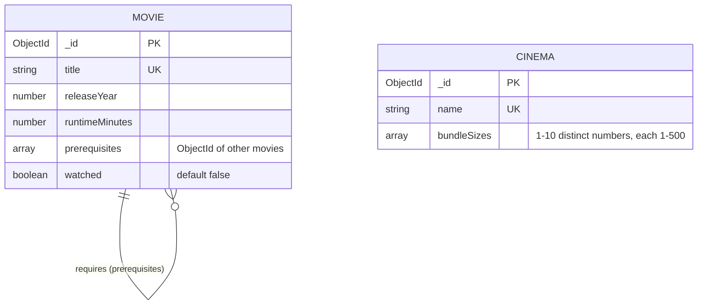

# Doomsday Ready

A small full-stack app that helps MCU fans plan their rewatch before *Avengers: Doomsday* and work out how to book an opening-night watch party when cinemas only sell seats in fixed bundles.

- **Rewatch planner:** movies with prerequisites, circular-dependency protection, and an ordered "watch these first" plan with progress and remaining time.
- **Watch-party booking:** cinemas with bundle sizes, and a quote for the fewest bundles that add up to exactly the group size.

> Built for the Blinto Talent Accelerator 2027 (Full Stack Developer Internship) assessment.

---

## Table of contents

1. [Tech stack](#tech-stack)
2. [Getting started](#getting-started)
3. [Project structure](#project-structure)
4. [Data model](#data-model)
5. [API reference](#api-reference)
6. [How the algorithms work](#how-the-algorithms-work)
7. [Decisions and assumptions](#decisions-and-assumptions)
8. [Testing the examples](#testing-the-examples)
9. [How I used AI](#how-i-used-ai)

---

## Tech stack

| Layer     | Choice                                                       |
| --------- | ------------------------------------------------------------ |
| Frontend  | React (Vite), React Router, Tailwind CSS                     |
| Backend   | Node.js, Express                                             |
| Database  | MongoDB, using the official `mongodb` driver (no Mongoose)   |

No libraries are used for the core logic of features 1 and 2 (cycle detection, rewatch ordering, booking quote). They are written by hand.

---

## Getting started

### Prerequisites

- Node.js 18+
- A running MongoDB instance (local, or a connection string)

### 1. Backend

```bash
cd backend
npm install
cp .env.example .env     # then edit values if needed
npm run dev              # starts on http://localhost:3000
```

Environment variables:

| Variable    | Default                     | Description                  |
| ----------- | --------------------------- | ---------------------------- |
| `PORT`      | `3000`                      | API port                     |
| `MONGO_URL` | `mongodb://localhost:27017` | MongoDB connection string    |

### 2. Frontend

```bash
cd frontend
npm install
npm run dev              # starts on http://localhost:5173
```

| Variable        | Default                 | Description          |
| --------------- | ----------------------- | -------------------- |
| `VITE_API_URL`  | `http://localhost:3000` | Base URL of the API  |

The backend enables CORS for `http://localhost:5173`.

### 3. Seed the example data (optional)

```bash
cd backend
```

<!-- TODO: add docker-compose.yml (mongo + backend + frontend), then confirm this section. -->

---

## Project structure

<!-- TODO: adjust to match the real folders. -->

```
.
backend/
├── controllers/
│   ├── movieController.js    # movie handlers (create, list, update, rewatch order)
│   ├── cinemaController.js   # cinema handlers (create, list, booking quote)
│   └── validators.js         # input validation
├── db/
│   └── db.js                 # MongoDB connection and indexes
├── routes/
│   ├── movieRoutes.js
│   └── cinemaRoutes.js
├── utils/
│   └── checkCircularDependency.js   # cycle detection (DFS)
├── index.js                  # Express app entry point
├── .env.example
└── package.json
```

---

## Data model

Two collections. Prerequisites and bundle sizes are stored inside the documents as arrays, so no join collection is needed.



Example documents:

```json
{
  "_id": "665f1a...03",
  "title": "The Avengers",
  "releaseYear": 2012,
  "runtimeMinutes": 143,
  "prerequisites": ["665f1a...01", "665f1a...02"],
  "watched": false
}
```

```json
{ "_id": "665f1b...01", "name": "Star Cineplex", "bundleSizes": [6, 9, 20] }
```

Indexes: unique on `movies.title` and unique on `cinemas.name`.

Constraints enforced in code:

- `runtimeMinutes` is an integer from 1 to 300.
- A cinema has 1 to 10 distinct bundle sizes, each an integer from 1 to 500.
- Prerequisite IDs must exist and must not create a cycle.

---

## API reference

All endpoints are under `/api`. Bodies and responses are JSON.

| Method | Path                                  | Purpose                                              |
| ------ | ------------------------------------- | ---------------------------------------------------- |
| POST   | `/movies`                             | Create a movie                                       |
| GET    | `/movies`                             | List movies                                          |
| PATCH  | `/movies/:id`                         | Update a movie (including `watched`, `prerequisites`)|
| GET    | `/movies/:id/rewatch-order`           | Ordered rewatch plan for a target movie              |
| POST   | `/cinemas`                            | Create a cinema                                      |
| GET    | `/cinemas`                            | List cinemas                                         |
| GET    | `/cinemas/:id/booking?groupSize=6`    | Booking quote                                        |

<!-- TODO: replace the example responses below with the real ones from your API. -->

### Create a movie

```http
POST /api/movies
```
```json
{
  "title": "The Avengers",
  "releaseYear": 2012,
  "runtimeMinutes": 143,
  "prerequisites": ["<ironManId>", "<firstAvengerId>"],
  "watched": false
}
```
`201 Created` returns the saved movie, including its `_id`.

### List movies

```http
GET /api/movies
```
```json
{ "count": 2, "movies": [ { "_id": "...", "title": "Iron Man", "...": "..." } ] }
```

### Update a movie

```http
PATCH /api/movies/:id
```
Send only the fields you want to change. If `prerequisites` is sent, it **replaces** the whole list.

```json
{ "watched": true }
```

### Rewatch order

```http
GET /api/movies/:id/rewatch-order
```
Returns every movie that must be seen before the target (prerequisites, their prerequisites, and so on), each exactly once, in an order where every movie comes after its own prerequisites. The target is not included. The response also reports how many of those movies are watched and the total runtime of the unwatched ones.

### Booking quote

```http
GET /api/cinemas/:id/booking?groupSize=44
```
For bundle sizes `6, 9, 20` this returns 4 bundles: 20 × 1, 9 × 2, 6 × 1. If no exact combination exists, the response says it is not possible.

### Errors

| Status | Code                     | When                                                         |
| ------ | ------------------------ | ------------------------------------------------------------ |
| 400    | `VALIDATION_ERROR`       | Missing or invalid fields (the `errors` array lists them)    |
| 400    | `INVALID_ID`             | A path `:id` is not a valid ObjectId                         |
| 400    | `PREREQUISITE_NOT_FOUND` | A prerequisite ID does not exist                             |
| 404    | `MOVIE_NOT_FOUND`        | The movie or cinema does not exist                           |
| 409    | `CIRCULAR_DEPENDENCY`    | The change would make a movie depend on itself, directly or indirectly |
| 409    | `DUPLICATE_TITLE`        | A movie with that title already exists                       |

Error responses look like `{ "error": "CIRCULAR_DEPENDENCY", "message": "..." }`.

---

## How the algorithms work

### Circular dependency check (feature 1)

When a movie's prerequisites are set, the new edges are applied to an in-memory copy of the graph (built from one `find()` of all movies). Then an iterative depth-first search starts from the new prerequisites and follows prerequisite links. If the search reaches the movie being edited, a cycle would exist, so the request is rejected with `409 CIRCULAR_DEPENDENCY` and nothing is saved. A movie listing itself is the one-step case of the same check.

A newly created movie cannot be in a cycle, because nothing can depend on it yet, so the check runs on `PATCH`.

Complexity: O(V + E).

### Rewatch order (feature 1)

A depth-first search from the target follows prerequisites. Each movie is added to the result only after all of its own prerequisites have been added (post-order), and a `visited` set guarantees each movie appears once. The target itself is left out. This is a topological order of the target's ancestors. The watched count and the remaining runtime (sum over unwatched movies) are computed from the same list.

Complexity: O(V + E).

<!-- TODO: confirm this matches your implementation. -->

### Booking quote (feature 2)

This is the minimum-coin-change problem, solved with dynamic programming. `dp[n]` is the fewest bundles that make exactly `n` seats, with `dp[0] = 0`. For each `n` from 1 to the group size, try every bundle size `s ≤ n` and keep the best `dp[n - s] + 1`. A `choice[n]` array records which size was used, so the answer is rebuilt by walking back from the group size. If `dp[groupSize]` is still infinite, no exact combination exists.

Greedy does not work here. For sizes `6, 9, 20` and a group of 44, greedy picks 20, 20 and then cannot finish, while the optimal answer is 20 + 9 + 9 + 6.

Complexity: O(groupSize × bundleSizes), at most 10,000 × 10 steps.

---

## Decisions and assumptions

The brief says to make reasonable choices where things are unclear. These are mine:

- **No authentication or users.** The brief does not mention it, so all endpoints are public. `watched` is a single flag on the movie, shared by everyone.
- **Booking is a quote only.** Nothing is saved when a quote is requested.
- **`PATCH` with `prerequisites` replaces the whole list**, rather than adding to it.
- **Release year** must be a whole number from 1900 to 2100 (the brief gives no range).
- **Several optimal answers:** when more than one minimal combination exists, one of them is returned.
- **`GET /movies` response shape** is `{ count, movies }`.
- **Prerequisite IDs** are validated against the database before saving.
- **Group size** must be a whole number from 1 to 10,000, and invalid values return `400`.
- **Cinema names and movie titles** are trimmed and compared exactly (case-sensitive).

---

## Testing the examples

The sample data from the brief:

| Movie                              | Watch these first                 |
| ---------------------------------- | --------------------------------- |
| Iron Man                           | None                              |
| Captain America: The First Avenger | None                              |
| The Avengers                       | Iron Man, The First Avenger       |
| Captain America: Civil War         | The Avengers                      |
| Thor: Ragnarok                     | None                              |
| Avengers: Infinity War             | Civil War, Ragnarok               |
| Avengers: Endgame                  | Infinity War                      |
| Avengers: Doomsday                 | Endgame                           |

Checks to try:

| Request                                          | Expected                                                      |
| ------------------------------------------------ | ------------------------------------------------------------- |
| Rewatch order for Avengers: Doomsday             | All 7 other movies, each after its prerequisites              |
| Rewatch order for Captain America: Civil War     | Iron Man and The First Avenger (either order), then The Avengers |
| Rewatch order for Thor: Ragnarok                 | Empty list                                                    |
| `PATCH` Iron Man with prerequisite Endgame       | `409 CIRCULAR_DEPENDENCY`                                     |

| Bundle sizes | Group size | Expected                                 |
| ------------ | ---------- | ---------------------------------------- |
| 1, 3, 4      | 6          | 2 bundles: 3 × 2                         |
| 2, 5         | 11         | 4 bundles: 5 × 1, 2 × 3                  |
| 6, 9, 20     | 44         | 4 bundles: 20 × 1, 9 × 2, 6 × 1          |
| 4, 6         | 7          | Not possible                             |

---

## How I used AI

<!-- TODO: edit this so it is accurate and in your own words. Be specific about what you did yourself. -->

I used Claude (Anthropic) as an assistant while working on this project. Specifically:

- **Understanding the brief:** asking for explanations of the requirements, such as what a circular dependency is and what `409 CIRCULAR_DEPENDENCY` means.
- **Data model:** discussing how to model prerequisites and bundle sizes in MongoDB.
- **Boilerplate and UI:** help with request validation helpers and with the React/Tailwind components.
- **Debugging:** diagnosing issues such as the API response shape and CORS/proxy configuration.

The core logic for features 1 and 2 (cycle detection, rewatch ordering and the booking quote) is my own work, and I can explain and modify it.
